# Architecture - Arcanes Scenario

Règle d'or : ni les pages ni les composants n'appellent `api` ou Dexie. Tout passe par un hook (`hooks/`) ou une fonction de `lib/services/`. `npm run check` le vérifie.

```mermaid
flowchart LR
  ELECTRON["Electron 44 (Windows)<br/>electron/main.cjs<br/>navigationPolicy.cjs"] --> PAGES
  ANDROID["Android (Capacitor)<br/>android/ - cap sync + Gradle"] --> PAGES

  subgraph PAGES["pages/"]
    direction TB
    Home
    Calendrier
    Codex
    Jeu
    Notes
    Tables
    Settings
  end

  subgraph SHARED["Partagé par toutes les pages"]
    direction TB
    UI["components/ui<br/>(Radix + Tailwind)"]
    COMMON["PrintButton<br/>CampaignSelect, QuestSelect"]
    SHELL["AppShell : menu,<br/>transition de page (rouleau)"]
  end

  subgraph FEAT["components/ par page"]
    direction TB
    F_HOME["home : SceneBoard, ActColumn,<br/>SceneEditor, MobileSceneList,<br/>CampaignDialog, QuestBar"]
    F_CAL["calendar : MonthGrid, SessionDialog,<br/>UpcomingSessions, SessionPollDialog<br/>poll/ : PollForm, PollCard,<br/>PollResultsTable, PollServiceUrlField,<br/>PollRemovalDialog"]
    F_CODEX["codex : CodexCard, CodexEntryDetails,<br/>CodexEntryDialog, LocationTree,<br/>CodexSidebar, EncounterDialog, NpcRelations,<br/>NpcSheetFields, NpcGeneratorPanel,<br/>AttachmentsField"]
    F_GAME["game : GameSheetModelEditor,<br/>GameCharacterEditor, GameCatalogPanel,<br/>InventoryPanel, GiveItemDialog,<br/>PcGeneratorPanel<br/>print : PrintSheet"]
    F_NOTES["notes : NoteCard, NoteEditor"]
    F_TABLES["tables : TableCard, TableEditor,<br/>DiceRoller<br/>home/GeneratorTablesDialog"]
    F_SET["BackupPanel, AutosavePanel,<br/>Tutorial/TutorialCenter"]
    F_THEME["theme : ThemeProvider, ThemeEditor,<br/>ThemeEditorDialog, AppearanceSection,<br/>CampaignThemeSection, ThemePreview"]
  end

  subgraph HOOKS["hooks/"]
    direction TB
    H_CAMP["useCampaigns, useQuests"]
    H_HOME["useCampaignContent<br/>useCampaignActions"]
    H_CAL["useScenes, useGameSessions,<br/>useSessionPolls,<br/>useSessionPollManager"]
    H_CODEX["useCodex, useCodexList,<br/>useCodexEntryData,<br/>useNpcRelations, useNpcGenerator,<br/>useNpcFormGeneration, useEncounters"]
    H_GAME["useGameSheet, useGameCatalog,<br/>useInventory, usePcFormGeneration"]
    H_NOTES["useNotes"]
    H_TABLES["useTables"]
    H_UI["useConfirm, usePendingOpenTick<br/>(sans données)"]
  end

  subgraph LIB["lib/"]
    direction TB
    META["meta/<br/>codex, inventory, encounter, sceneMeta,<br/>sessionMeta, sessionCampaign, tableMeta,<br/>relationMeta, universeMeta"]
    CTX["context/<br/>campaignStore, questStore, RefreshContext,<br/>PageFilterContext, ExpandedCardContext,<br/>CodexLinksContext, TabStackContext, dataEvents, AuthContext"]
    SERV["services/<br/>campaignDelete, quests, inventory, encounters,<br/>locationTree, npcRelations, attachments,<br/>codexEntries, codexSearch,<br/>npcGeneration, openAttachment,<br/>appSettings, themeFile"]
    POLLS["services/polls<br/>config, client (fetch), remote,<br/>votes, sync, pollDates, pollForm,<br/>store (façade : sessionPolls.js)"]
    PRINT["print/<br/>printModel, editablePdf,<br/>loadPrintData"]
    GEN["generators/<br/>nameGenerator, nameData, random,<br/>npcData, generatorTables, npcGenerator,<br/>npcScale, scaleDraft, npcRequest,<br/>pcScale, pcGenerator, pcRequest"]
    SAVE["save/<br/>backup, autosave, accountData,<br/>nativeShare"]
    THEME["theme/ (pur)<br/>tokens, color, contrast, palette,<br/>presets, fonts, validate, resolve,<br/>editor, gameTable"]
    MISC["à la racine, non classés :<br/>utils, query-client"]
  end

  subgraph DATA["api/"]
    direction TB
    API["localClient.js<br/>api (entities), réexporte db et TABLES"]
    EF["entityFactory.js<br/>makeEntity : CRUD"]
    DBC["dbConfig.js<br/>db (Dexie), TABLES, versions v1 à v7"]
    LU["localUser.js<br/>LOCAL_USER"]
    TAB[("IndexedDB<br/>schéma v1 à v7")]
  end

  POLL(["Service de sondage externe<br/>arcanes-planification.pages.dev<br/>(HTTPS, URL configurable)"])
  NATIVE(["Plugins Capacitor<br/>filesystem, share (Android)"])
  RESTORE["RestorePrompt"]

  %% Pages -> composants
  Home & Calendrier & Codex & Jeu & Notes & Tables & Settings --> SHARED
  Home --> F_HOME & F_CODEX
  Calendrier --> F_CAL
  Codex --> F_CODEX
  Jeu --> F_GAME
  Notes --> F_NOTES
  Tables --> F_TABLES
  Settings --> F_SET & F_THEME
  F_THEME --> THEME
  F_THEME -->|appSettings, themeFile| SERV

  %% Pages -> hooks
  Home & Calendrier & Codex & Jeu & Notes & Tables & Settings --> H_CAMP
  Home --> H_HOME
  Calendrier --> H_CAL
  Codex --> H_CODEX
  Jeu --> H_GAME
  Notes --> H_NOTES
  Tables --> H_TABLES

  %% Composants -> hooks et services (jamais api)
  F_CODEX --> H_CODEX
  F_CODEX -->|AttachmentsField, CodexEntryDialog| SERV
  F_CODEX -->|noms aléatoires| GEN
  F_CAL -->|SessionPollDialog| H_CAL
  F_CAL -->|formulaire, libellés| POLLS
  COMMON -->|PrintButton| PRINT

  %% Pages -> lib (constantes, contextes d'interface, aides)
  Home & Codex & Tables & Calendrier --> META
  Home & Calendrier & Codex & Jeu & Tables --> CTX
  Codex --> SERV
  Calendrier --> POLLS
  Settings --> SAVE

  %% Hooks -> lib
  H_CAMP --> CTX
  H_HOME & H_CAL & H_CODEX & H_GAME & H_NOTES & H_TABLES --> CTX
  H_HOME --> META & SERV
  H_CODEX --> META & SERV & GEN
  H_CAL --> POLLS & META

  %% Accès aux données (seuls hooks, services et save touchent api/db)
  H_CAMP & H_HOME & H_CAL & H_CODEX & H_GAME & H_NOTES & H_TABLES --> API
  SERV --> API
  POLLS --> API
  PRINT --> API
  PRINT --> SERV
  F_SET --> SAVE
  F_SET & F_GAME --> H_UI
  SAVE -.->|export Android| NATIVE
  SAVE --> API
  RESTORE --> SAVE
  API --> EF
  API --> DBC
  EF --> DBC
  EF --> LU
  DBC --> TAB

  %% Réseau
  POLLS ==>|fetch| POLL
```

## État du refactor

- Les 7 pages et les composants n'importent plus `api` : seuls `hooks/`, `lib/` et `api/` y accèdent. Le script `scripts/check-refactor.mjs` (`npm run check`) échoue si une page ou un composant le fait.
- `lib/` est découpé en `meta`, `context`, `services` (avec `services/polls`), `save`, `print` et `generators`.
- `src/api/` est découpé en `dbConfig.js` (Dexie, `TABLES`, versions), `entityFactory.js` (`makeEntity`), `localClient.js` (`api`) et `localUser.js` (`LOCAL_USER`).
- `openAttachment` est dans `lib/services/` : types MIME autorisés (pdf, png, jpeg, gif, webp, avif), URL distantes en https uniquement.
- ESLint (`eslint.config.js`) couvre tout `src/` sauf `components/ui/`.
- `Layout` est dans `components/` et `PageNotFound` dans `pages/`.
- `RestorePrompt` passe par `lib/save/backup.js` (`hasCampaigns`) et n'accède plus à `db`.
- `sessionPolls.js` est une façade qui réexporte les fichiers de `services/polls/`.
- La confirmation de suppression d'un sondage depuis la page Calendrier passe par une `AlertDialog` (plus de `window.confirm` dans `useSessionPolls`).
- `SessionPollDialog` est découpé en quatre couches : `lib/services/polls/pollForm.js` (validation, charge utile, aides de dates : fonctions pures), `lib/services/polls/remote.js` (appels au service distant avec le `owner_token` ; `removeSessionPoll` est l'unique chemin de suppression, partagé avec `useSessionPolls`, un 404 du service n'est pas une erreur), `hooks/useSessionPollManager.js` (état du formulaire, liste des sondages, actualisation, clôture, suppression) et `components/calendar/poll/` (`PollServiceUrlField`, `PollForm`, `PollCard`, `PollResultsTable`, `PollRemovalDialog`). La fenêtre elle-même ne fait plus qu'assembler l'affichage.
- `useConfirm()` (`hooks/useConfirm.jsx`) remplace tous les `window.confirm` : `BackupPanel`, `AutosavePanel` (restauration) et `GameCharacterEditor` (×2). Il renvoie une promesse et fournit `confirmDialog` à afficher dans le JSX.
- `deleteCampaignCascade` (`lib/services/campaignDelete.js`) s'exécute dans une seule transaction Dexie : en cas d'erreur, y compris la vérification finale, rien n'est supprimé.
- Android : `lib/save/nativeShare.js` exporte la sauvegarde par la feuille de partage (plugins `@capacitor/filesystem` et `@capacitor/share`, chargés à la demande). Sans sauvegarde automatique (Android, navigateur), `BackupPanel` exporte l'état actuel avant tout import.
- Plus d'avertissement de lint : `usePageFilter` destructure `setFilter`.
- Fins de ligne LF et UTF-8 sans BOM : `.gitattributes` et `.editorconfig` à la racine.
- `useCodexList` échappe le terme de recherche avant de le passer à `$regex` (une recherche comme `a.c` ou `(` est traitée comme du texte).
- Testés à la main par l'utilisateur le 17/10/2026, tout passe : export Android (feuille de partage), import avec export préalable, les confirmations `useConfirm` (dont celle de la fiche personnage sur mobile) et la suppression de campagne.
- `progress` (statuts des scènes) n'est plus calculé : aucune page ne l'utilisait.

## Génération de PNJ et Codex (1.6)

- `lib/generators/` est pur (aucun accès aux données) : tirage à graine, données par univers, tables du MJ fusionnées avec les tables intégrées, `generateNpc`, barème (`npcScale`) et `npcRequest`. Le chargement et l'enregistrement passent par `lib/services/npcGeneration.js` et `hooks/useNpcGenerator.js` ; `useNpcFormGeneration` remplit le formulaire (cadenas, confirmation avant écrasement, genre comme paramètre).
- Les verrous (cadenas) sont enregistrés avec le PNJ dans `NPC.generation_locks` (`{ rubrique: true }`) et relus à la modification (`useNpcFormGeneration` reçoit `initialLocks`). Dexie `update` fusionne les lignes : pas de nouvelle `db.version`.
- Les tables du MJ sont dans `Campaign.generator_data`, le barème dans `GameSheetModel.scale` : pas de nouvelle `db.version`, la sauvegarde les inclut déjà. Le bouton « Tables du générateur » est sur la page Tables aléatoires (`components/home/GeneratorTablesDialog.jsx`).
- La fiche d'un PNJ suit la forme d'une fiche de personnage : caractéristiques `{ value, fields }`, compétences et équipement avec champs facultatifs.
- Codex : `CODEX_PAGE_TABS` (PNJ, lieux, indices) pour la page, `CODEX_TABS` (avec personnages) pour le panneau de l'accueil. `CodexEntryDetails` affiche une fiche entière (cartes et panneau, y compris les personnages du panneau de l'accueil). La recherche (`lib/services/codexSearch.js`, fonctions pures) parcourt toute la fiche et accepte des filtres `rubrique:"valeur"`. Les valeurs et liens cliquables passent par `CodexLinksContext`, fourni par la page Codex et par `CodexSidebar`.

## Version 1.6.1 (26/10/2026) : ajouts depuis 1.6.0

- **Calendrier toutes campagnes.** `useGameSessions` charge les sessions d'une campagne ou de toutes (interrupteur « Toutes les campagnes », nom de la campagne affiché). `saveSession(form, { campaignName })` range une nouvelle session dans la campagne choisie dans `SessionDialog`, ou crée une campagne vierge (`{ name, system: "", summary: "", universe_type: "arcanes" }`) quand la valeur est `NEW_CAMPAIGN` (`lib/meta/sessionCampaign.js`), dans `withDataBatch` : si l'enregistrement échoue, la campagne créée est supprimée.
- **Catalogues de la page Jeu.** Onglets Personnages, Compétences, Équipements (`GameTabBar` et `GameCatalogPanel` dans `components/game/GameCatalogPanel.jsx`, données par `hooks/useGameCatalog(campaignId, kind)` sur les entités `SkillCatalog` et `EquipmentCatalog`). Ajout, modification et suppression ; deux éléments ne peuvent pas porter le même nom ; un équipement garde les valeurs de ses champs facultatifs conservés. Les fiches gardent leur propre copie : renommer ou supprimer dans le catalogue ne modifie jamais une fiche existante, et il n'y a pas de bouton de synchronisation (volontaire : il écraserait des retouches manuelles).
- **Transition de page « rouleau ».** `AppShell.jsx` intercepte le clic sur un lien du menu (`a[href^='#/']`), pose `data-turn="forward"|"back"` sur `<html>` (sens selon `PAGE_ORDER`) et lance `document.startViewTransition` ; la navigation se fait dans le callback, qui attend (`settle`, avec `setTimeout`, car `requestAnimationFrame` est gelé pendant la capture) que la nouvelle page soit affichée. Les règles sont à la fin de `index.css`, hors des couches Tailwind (sous le commentaire « Page de grimoire — rouleau (version finale) »), sinon elles sont retirées à la compilation : la nouvelle page est dessous, l'ancienne dessus, masquée par un dégradé (`--roll`, déclaré par `@property`, animé 800 ms, 600 ms sur petit écran ; angle `--roll-angle` 250deg avant, 70deg arrière) ; un élément vide `.page-roll` porte la bande d'ombre ; `.page-transition` reçoit un fond opaque pendant la transition (sinon la nouvelle page se voit à travers l'ancienne). `html[data-vt]` coupe le petit glissement d'origine (`page-enter`) quand la transition de vue prend la main ; sans transition de vue ou avec animations réduites, il reste actif. Une seule animation à la fois (un clic pendant une animation navigue normalement). `App.jsx` précharge les pages après 1,5 s.
- **Scène visible.** `ActColumn.jsx` (repère `data-scene-id` sur chaque scène) ramène l'acte et la scène sélectionnée dans la zone visible 260 ms après l'élargissement de la colonne : défilement horizontal du tableau, à gauche du panneau Codex (`aside[data-keep-expanded]`), et vertical de la page, avec 24 px de marge.
- **Bordure des fiches sélectionnées.** La bordure lumineuse (`ring-2`) dépasse de 2 px : une grille de fiches avec `overflow-hidden` doit avoir `-m-1 w-[calc(100%+0.5rem)] max-w-none p-1` (Codex, Tables aléatoires, Notes).
- Badge d'état (allié, hostile, neutre ; indice caché, info connue) au-dessus du nom, sur la carte du Codex et dans le panneau de l'accueil.
- Fenêtre de modification du Codex : titre « Modifier — nom saisi ». Bouton « Ajouter un équipement » sous le libellé « Équipement » des fiches de PNJ.

## Version 1.6.2 : quêtes, ordre des onglets, outils de contrôle

- **Arbre Campagne > Quête > Acte > Scène.** L'entité `Quest` (déjà dans le schéma v5, donc sans nouvelle `db.version`) porte `campaign_id`, `title` (« Quête principale » par défaut) et `order`. `Act.quest_id` et `Scene.quest_id` rattachent les éléments ; `Scene.recurring_group` non vide marque une scène récurrente.
- **`lib/services/quests.js`** concentre la logique : `loadQuests`, `ensureQuests` (migration), `createQuest`, `renameQuest`, `deleteQuest`, `makeRecurring`, `stopRecurring`. `ensureQuests` tourne dans `loadTree` (`useCampaignContent`), dans une seule transaction Dexie (relecture à l'intérieur, écritures silencieuses) : les actes et scènes sans quête sont adoptés par la première quête ; « Quête principale » n'est créée que si la campagne n'a aucune quête et a des éléments sans quête. Une campagne peut finir sans quête (la dernière quête est supprimable et n'est pas recréée).
- **Scènes récurrentes** : une copie indépendante dans chaque quête, même `recurring_group`. `createQuest` copie chaque groupe dans la nouvelle quête. Une copie reprend les liens (PNJ, lieux, indices, personnages ; `next_scene_ids` seulement vers les copies faites dans le même appel) et démarre en « brouillon ». Supprimer une copie ne supprime pas les autres.
- **Quête active** : `lib/context/questStore.js` (localStorage `arcanes_quest_id:<campagne>` avec repli en mémoire) lu par `hooks/useQuests.js` ; `components/common/QuestSelect.jsx` est affiché à côté de `CampaignSelect` (masqué s'il y a moins de 2 quêtes). La page Home filtre actes et scènes sur la quête active (`QuestBar` : choisir, renommer, supprimer, créer ; `SceneEditor` : choix de la quête, interrupteur « Scène récurrente »). Sur Codex, Tables, Notes et Jeu, le sélecteur ne fixe que la quête proposée par défaut à l'impression. Le Calendrier filtre « Scène prévue » sur la quête active mais garde la scène déjà liée (`useScenes` ajoute `in_quest` et `quest_title`).
- **Impression par quête** : `scopeToQuests` (`lib/print/printModel.js`) puis `buildTrees` (niveau « Quête » s'il y en a plusieurs) et `buildPrintModel` (un bloc « Scènes · quête » par quête, titre seulement si la campagne a plusieurs quêtes). Les lignes sans `quest_id` appartiennent à la première quête. `PrintButton` propose une case par quête, une au moins reste cochée.
- **Ordre des onglets** : Arborescence, Codex, Système de jeu, Notes de MJ, Tables, Calendrier, Paramètres. À modifier ensemble dans `SideRail.jsx`, `MobileNav.jsx`, `TabStackContext.jsx` (TAB_ROOTS), `MobileBackBar.jsx`, `AppShell.jsx` (`PAGE_ORDER`, sens du rouleau) et `config/tutorials.js`.
- **Tests automatiques** : `npm test` (Vitest + `fake-indexeddb`, `vitest.config.js`, dossier `tests/` hors du périmètre ESLint). La vraie couche Dexie tourne sur une IndexedDB simulée vidée avant chaque test. Couverture : entités, quêtes (dont trois `ensureQuests` simultanés), suppression de campagne et annulation, sauvegarde aller-retour et restauration atomique, arbre des lieux, relations de PNJ, recherche du Codex, générateurs et barèmes, impression par quête, sondages. 81 tests verts au 28/10/2026.
- **Inventaire** : `npm run inventaire` (`scripts/inventaire.mjs`) écrit `Docs/inventaire-<date>.md` : fichiers orphelins, exports inutilisés, usage par page, comparaison avec `Docs/Fonctionnalites.md` (indices à vérifier à la main). Il refuse d'écraser un rapport sans `--force`.

## Version 1.6.3 : inventaire

- **Données.** Un champ `inventory` (liste d'objets `{ id, name, quantity, notes, catalog_id, fields }`) sur `NPC`, `GameCharacter` et `Campaign` (la réserve « Sans propriétaire » : objets qui n'appartiennent à personne). Pas de nouvelle table ni de nouvelle `db.version` ; sauvegarde, sauvegarde automatique et suppression de campagne le couvrent déjà. L'équipement de la fiche reste une liste à part (ce que le personnage utilise).
- **`lib/meta/inventory.js`** (fonctions pures) : nettoyage, ajout qui additionne un objet identique, liste des propriétaires (réserve, personnages, PNJ), suggestions de noms tirées des inventaires de la campagne, ligne imprimable. **`lib/services/inventory.js`** : `loadOwners`, ajout, quantité, suppression et `transferInventoryItem` (don, entier ou partiel, retrait et ajout dans la même transaction Dexie). Chaque écriture relit la fiche dans la transaction.
- **Écrans** : onglet « Inventaire » du Système de jeu (`InventoryPanel`, `GiveItemDialog`), `AddToInventoryDialog` (depuis les Tables aléatoires et depuis l'onglet, réserve par défaut), `OwnerPicker` (recherche dans le choix du propriétaire), `InventoryField` (section des fiches de personnage et de PNJ). Le hook `useInventory` charge les propriétaires et expose ajout, quantité, suppression et don ; `useInventoryCatalog` fournit les suggestions.
- **Impression et PDF** : nouvelle section « Inventaires » de `printModel` (réserve, personnages, PNJ qui ont des objets), bloc `inventories`, inventaire sur les fiches de personnage et de PNJ (champ vide dans le PDF s'il n'y a aucun objet). Le préréglage `inventory` de `PrintButton` s'applique quand l'onglet Inventaire de Jeu est affiché.
- La recherche du Codex retrouve un PNJ d'après ses objets.
- Tests : `tests/inventory.test.js` (règles pures), `tests/inventoryService.test.js` (service, réserve et don), `tests/printModel.test.js` (impression des inventaires).

## Version 1.6.4 : génération de personnages joueurs

- **Barème des PJ** : un seul profil sans niveaux (`GameSheetModel.pc_scale` : plage par caractéristique, nombre de compétences et d'équipements), distinct du barème des PNJ. Nettoyage, contrôle (`checkPc`, avertissements seulement) et renommage dans `lib/generators/pcScale.js`. Pas de nouvelle `db.version`.
- **Générateur** : `pcGenerator.js` (pur, à graine : nom, caractéristiques, compétences et équipement tirés dans les catalogues de la campagne) et `pcRequest.js` (contexte de campagne). Verrous enregistrés dans `GameCharacter.generation_locks`. L'inventaire n'est pas généré.
- **Écrans** : panneau « Générer la fiche » dans `GameCharacterEditor` (`PcGeneratorPanel`, `usePcFormGeneration` : cadenas, confirmation avant écrasement, écarts au barème en direct). Dans l'éditeur du modèle, trois sections repliables (Caractéristiques, Barème des PNJ, Barème des personnages joueurs). Le barème des PNJ se dérive des fiches de PNJ (`useGameSheet` charge aussi les PNJ), celui des PJ des personnages joueurs.
- Tests : `tests/pcGenerator.test.js` (barème, génération, verrous, brouillon, renommage).

## Version 1.7.0 : notes de MJ en post-it

- **Données.** Champs facultatifs sur `Note` : `target_kind`, `target_id`, `part_kind`, `part_id`. Pas de nouvelle table ni de nouvelle `db.version`. Une note sans cible est une note libre ; les notes existantes le restent.
- **`lib/meta/postit.js`** (pur) : cibles, clés, comptes (`direct` et `total`), description (`describeTarget`, orphelins signalés). **`lib/services/notes.js`** : libellés des cibles, identifiants stables des compétences et équipements, détachement, suivi du renommage d'une caractéristique.
- **Écrans** : `PostItProvider` (dans `Layout`) et `PostItDialog` ; boutons `PostItButton` / `PartPostItButton` sur les scènes, fiches du Codex et leurs parties, personnages, caractéristiques, compétences, équipements et objets d'inventaire ; pastille avec le nombre de post-it. Page « Notes de MJ » : puce de cible, filtres (libres, collés, orphelins, par élément), détacher, rattacher (`AttachNoteDialog`, avec choix de la partie de fiche).
- **Impression et PDF** : le bloc « Notes du MJ » indique l'élément de chaque post-it.
- Limites : donner un objet d'inventaire laisse son post-it chez l'ancien propriétaire (orphelin) ; régénérer un PJ orpheline les post-it de ses compétences et équipements remplacés.
- Tests : `tests/postit.test.js` (règles pures ; les cas qui touchent la base ne tournent que sur le PC de l'utilisateur), `tests/printModel.test.js`.

## Version 1.7.1 : visionneuse, PDF de campagne, notes de version

- **Visionneuse de pièces jointes** : `AttachmentViewer` et `useAttachmentViewer` (image avec zoom, PDF, précédent/suivant, enregistrer, partager), ouverte depuis les cartes et la liste du Codex ; `lib/services/attachmentFile.js` (types autorisés, blob, téléchargement, partage ; SVG et HTML refusés), `shareBase64File` pour Android.
- **PDF de campagne** (onglet « PDF » des Notes de MJ) : deux tables, `CampaignDocument` (informations) et `CampaignDocumentFile` (contenu), `db.version(6)`. La liste ne lit jamais les fichiers (50 Mo maximum chacun). `FILE_TABLES` : exclues de la sauvegarde automatique (`buildBackupPayload({ light: true })`), incluses dans l'export manuel, laissées intactes par une restauration qui ne les contient pas, supprimées par clés avec la campagne.
- **Notes de version** : clic sur la version dans Paramètres (`ReleaseNotesDialog`) : résumé automatique (introduction et titres des nouveautés), version complète à la demande, versions précédentes. Source : `Docs/releases/RELEASE-X.Y.Z.md` embarqués à la compilation (`import.meta.glob`).
- **Tailwind 4** : configuration dans `src/index.css` (plugin Vite `@tailwindcss/vite`, `@theme inline`, `@plugin tailwindcss-animate`) ; `stack-x-*` / `stack-y-*` remplacent `space-x-*` / `space-y-*` (comportement de Tailwind 3). Voir `AGENTS.md`, section TAILWIND 4.
- **Mises à jour** (Windows, sur demande) : bouton « Vérifier les mises à jour » dans Paramètres › À propos (`UpdatePanel`, hook `useAppUpdate`) ; `electron/main.cjs` pilote `electron-updater` (canaux `update:check`, `update:download`, `update:install`, pont `window.arcanesUpdate`) avec GitHub Releases comme source. Voir `AGENTS.md`, section UPDATES AND SIGNING.
- Tests : `tests/attachmentFile.test.js`, `tests/releaseNotes.test.js`, `tests/campaignDocument.test.js`, `tests/campaignDelete.test.js`.

## Version 1.8.0 : thèmes et apparence

- **Un thème est une donnée** (`{ presetId, appearance, palette, overrides, titleFont, radius, iconStroke, pattern, iconColor }`), jamais du code ni du CSS libre. `ThemeProvider` (qui remplace `next-themes`) l'applique en variables CSS sur `<html>` ; les couleurs de Tailwind lisent `hsl(var(--jeton))` ; la classe `dark` est la seule source de vérité clair/sombre. Aucune couleur n'est écrite en dur dans un composant (jetons `primary`, `warning`, `played`, `icon`...).
- **Modules purs** dans `lib/theme/` (sans React, Dexie ni alias `@/` : importables par Node) : `tokens`, `color`, `contrast` (WCAG 2.1 AA), `palette` (une couleur d'accent → les 40 jetons, trois harmonies), `presets` (Arcanes identique à `index.css` + six ambiances dérivées), `fonts`, `validate` (liste blanche, jamais d'exception), `resolve` (thème → variables, attributs, cache de démarrage), `editor` (opérations de l'éditeur), `gameTable` (surcouche).
- **Stockage** : table `AppSettings` (une ligne `global` : thème par défaut, taille du texte, police du texte, animations, mode table de jeu), `db.version(7)` ; thème d'une campagne = champ facultatif `theme` de la ligne `Campaign`. `NON_CAMPAIGN_TABLES` (`Campaign`, `AppSettings`) sort ces tables de la suppression en cascade. Services : `lib/services/appSettings.js` (réglages, thème de campagne) et `themeFile.js` (export et import JSON). La sauvegarde, la sauvegarde automatique et la restauration l'incluent ; « Effacer toutes les données » réinitialise aussi le thème.
- **Démarrage sans flash** : un script de `index.html` lit `localStorage["arcanes_theme_boot"]` (écrit par le fournisseur pour le thème enregistré seulement) et pose classe, variables et attributs avant React. Electron : `arcanesTheme.setWindowBackground` (canal `theme:set-window-background`) règle le fond de la fenêtre.
- **Polices embarquées** (Fontsource, import par graisse dans `main.jsx`) : Cinzel, Almendra, IM Fell English, Playfair Display, Chakra Petch, Orbitron, Pirata One pour les titres ; Inter et Atkinson Hyperlegible pour le texte ; JetBrains Mono. `npm run check:fonts` vérifie les caractères du français.
- **Éditeur** : `ThemeEditor` (unique, contrôlé) dans `ThemeEditorDialog` (brouillon, aperçu en direct dans toute l'application, Annuler restaure, Appliquer enregistre, réinitialiser, export et import) ; utilisé par `AppearanceSection` (Paramètres) et `CampaignThemeSection` (fenêtre de la campagne). Avertissement de contraste non bloquant avec correction automatique ; réglages avancés séparés pour le clair et le sombre.
- **Mode table de jeu** : surcouche calculée à l'affichage (fonds plus sombres, contraste 7 : 1, texte ×1,1, sans animations ni flou, zones cliquables de 44 px) ; le thème enregistré n'est jamais modifié.
- **Contrôles** : `npm run check:themes`, `npm run check:fonts`, `tests/theme.test.js`. Impression et PDF : pas encore thémés. Icônes : Lucide conservé.

## Version 1.9.0 : recherche globale

- `components/common/GlobalSearch.jsx` (monté dans `AppShell`) : Ctrl+K, loupe de `SideRail` et de `MobileBackBar`, résultats groupés, navigation clavier. Données : `hooks/useGlobalSearch.js` ; moteur pur : `lib/services/globalSearch.js` ; état partagé sans React : `lib/context/searchStore.js` (demande d'ouverture de la fenêtre, élément à ouvrir à l'arrivée sur la page, périmé après 5 s).
- Les pages Home, Codex, Notes et Tables prennent l'élément choisi avec `takePendingOpen` quand leurs données sont chargées. Pas de nouvelle `db.version`.

## Version 1.10.0 : corbeille

- Table `Trash` (`db.version(8)`), alimentée par `api/trashCapture.js` (`captureDeleted`, appelé par `entityFactory.delete` et `deleteMany`) : une ligne = un groupe de lignes supprimées par une même action (`withTrashGroup`). Service : `lib/services/trash.js` (liste, restauration en transaction, suppression, purge à 30 jours) ; hook `useTrash` ; écran `TrashPanel` dans Paramètres.
- La corbeille est locale à l'appareil (`LOCAL_ONLY_TABLES`) : hors sauvegardes et sauvegarde automatique. PDF de campagne et sondages exclus.

## Version 1.11.0 : journal de séance

- Champ `journal` de `GameSession` (`{ summary, scene_ids, npc_ids, clue_ids, next }`), sans nouvelle table ni `db.version`. Règles pures : `lib/meta/sessionJournal.js` ; enregistrement : `lib/services/sessionJournal.js` (n'écrit que `journal`) ; chargement : `hooks/useSessionJournals.js`.
- Interface : `SessionJournalDialog` et `SessionJournalList` (page Calendrier), bouton dans `SessionDialog`. Les séances sont aussi un groupe de la recherche globale.

## Version 1.12.0 : tutoriel interactif

- Trois visites guidées (`tour-1` application vide, `tour-2` et `tour-3` sur une campagne d'exemple), lancées depuis Paramètres › Tutoriel. Une visite ne fait rien utiliser : elle change d'onglet, ouvre et referme elle-même fiches et fenêtres, et affiche une bulle à côté de l'élément, sans assombrir l'écran.
- `config/tutorials.js` (étapes), `components/Tutorial/` (`TutorialProvider`, `TutorialOverlay`, `TutorialCenter`), `lib/tutorial/placement.js` (placement de la bulle, pur) et `lib/tutorial/dom.js` (recherche d'éléments, actions génériques `dom.click` et `dom.closeDialog`), `lib/context/tutorialBridge.js` + `hooks/useDemoAction.js` (actions déclarées par une page).
- Campagne d'exemple : `data/demoCampaign.json` (identifiants fixes), `lib/services/demoCampaign.js` (ajout en une transaction, suppression complète), `lib/services/demoTour.js` (entrée et sortie : la campagne de la personne est remise en place), `lib/meta/demoDates.js`, `hooks/useDemoCampaign.js`. Pas de nouvelle `db.version`.
- Tests : `tests/tours.test.js` (cohérence des étapes avec le code et la campagne d'exemple), `tutorialPlacement`, `tutorialBridge`, `demoCampaign`, `demoTour`, `demoDates`. Notes détaillées : `Docs/Tutoriel.md`.
- Mise en page mobile : les grilles à une colonne sur téléphone portent `grid-cols-1` (sinon la page s'élargit au contenu le plus large).

## Suivi de rencontre (1.13.0)

- Table `Encounter` (`db.version(9)`) : une ligne par rencontre d'une campagne (`title`, `round`, `active_id`, `combatants` : `{ id, name, initiative, hp, hp_max }`). Elle est dans `LINKED_ENTITIES` (suppression de la campagne) et dans la corbeille. La version 8 de `dbConfig.js` garde ses tables d'origine (`VERSION_8_TABLES`) : sans cela, Dexie ne créerait pas la nouvelle table chez quelqu'un qui a déjà des données.
- Règles pures : `lib/meta/encounter.js` (ordre d'initiative, PV bornés, tour suivant, retrait du combattant qui joue). Enregistrement : `lib/services/encounters.js` (une transaction qui relit la ligne ; écritures silencieuses pour ne pas recharger tous les écrans à chaque point de vie). Hook : `hooks/useEncounters.js` (mise à jour de l'écran d'abord, puis écriture, relecture en cas d'échec).
- Interface : bouton aux deux épées à côté de « Codex du MJ » dans `CodexSidebar`, qui ouvre `EncounterDialog`. Un combattant à 0 PV est grisé mais garde son tour. Initiative saisie à la main (tirage de dés prévu plus tard). Pas d'impression ni de recherche globale pour l'instant.

## Plateformes

- **Electron 44.9.0 (Windows)** : `electron/main.cjs`, `preload.cjs` et `navigationPolicy.cjs` (`window.arcanesPdf`, `window.arcanesBackup`, sauvegardes dans `Documents\Arcanes Scenario`). La fenêtre est en `sandbox`, avec isolation de contexte ; les canaux IPC (`handle()`) n'acceptent que la page principale ; `window.open` n'autorise que `blob:` (liens `https:`/`http:`/`mailto:` envoyés au système, reste refusé) ; la fenêtre principale ne navigue que vers `file:`. Installateur via `npm run dist`.
- **Android (Capacitor)** : `android/`, config dans `capacitor.config.ts` (`webDir: "dist"`). Flux : `npm run build`, `npx cap sync android`, puis APK avec Gradle depuis Android Studio. Les ponts Electron n'existent pas sur Android ; l'export manuel passe par `@capacitor/filesystem` et `@capacitor/share`. La version Android (`versionName`, `versionCode` dans `android/app/build.gradle`) est indépendante de `package.json` : à mettre à jour à chaque release (1.8.0 = 180).
- Le même code React (`src/`) sert aux deux.

- Sécurité du 19/10/2026 : `@capacitor/assets` retiré (inutilisé, il tirait `tar` 6 et `sharp`), Electron 31.7.7 -> 44.9.0, react-router-dom 6.30.6 -> 7.18.4, tous les paquets en `devDependencies` (l'installateur n'embarque plus de `node_modules` d'exécution : l'interface est déjà regroupée par Vite). `electron/main.cjs` durci (voir Plateformes). `npm audit` : 26 alertes dont 1 critique -> 20 (15 modérées, 5 hautes), voir ci-dessous.

## Ce qui reste à traiter

- `utils.js` et `query-client.js` sont à la racine de `lib/`, non classés.
- Les sélecteurs de quête de Codex, Tables, Notes et Jeu ne servent qu'à l'impression par défaut : ces pages n'affichent pas leur contenu par quête.
- `npm audit` : 25 alertes acceptées au 1/11/2026 (0 critique, 0 haute, 25 modérées). La chaîne `tailwindcss` 3 a disparu avec la migration vers Tailwind 4 ; `electron` 44.10.1 et les mises à jour du fichier de verrouillage (`undici`, `fast-uri`) ont fermé les deux hautes. Restent : `@capacitor/cli` via `xcode`/`uuid` (la correction proposée est un retour en arrière), la chaîne d'emballage `electron-builder` et `minimatch` côté ESLint (build et lint seulement). Ne pas lancer `npm audit fix --force`. `npm audit --omit=dev` renvoie 0 parce que tout est en `devDependencies` : ce n'est pas une preuve que l'interface est sans alerte.

## Points non vérifiés

- Les flèches de `META` et `CTX` depuis les pages sont déduites des imports lus, pas d'une analyse complète.
- Le pont `window.arcanesBackup` (Electron) est utilisé par `lib/save/autosave.js` et `AutosavePanel`. `electron/` a été relu le 19/10 et testé à la main par l'utilisateur sous Electron 44.9.0 (sauvegarde automatique, PDF éditable, impression, pièce jointe, liens et courriel des sondages, correcteur, menu contextuel, `release\win-unpacked`).
- `tsc` n'a jamais été lancé ; `openAttachment` (option `noopener`) n'a pas été testé sous Android (WebView). Les changements des versions Electron 32 à 43 n'ont pas été relus un par un : seule la page des changements de la 44 l'a été, la validation repose sur les tests manuels.
- Le cas d'une très grosse base avec beaucoup d'images n'a pas été précisé lors des tests de l'export Android.
- Transition de page « rouleau » : testée par l'utilisateur sous Windows (Electron) et sous Android.
- Quêtes et nouvel ordre des onglets : testés à la main sous Windows (28/10/2026), logique couverte par `npm test` ; non testés sous Android.
- Visionneuse, PDF de campagne et notes de version (1.7.1) : testés à la main sous Windows (31/10/2026) ; non testés sous Android (feuille de partage, PDF) ; les tests de base de données ne tournent que chez l'utilisateur.
- Post-it (1.7.0) : testés à la main sous Windows (31/10/2026) ; tests de base de données seulement chez l'utilisateur ; non testé sous Android.
- Inventaire : testé à la main sous Windows (29/10/2026) ; les tests du service ne tournent que sur le PC de l'utilisateur (IndexedDB simulée) ; non testé sous Android.
