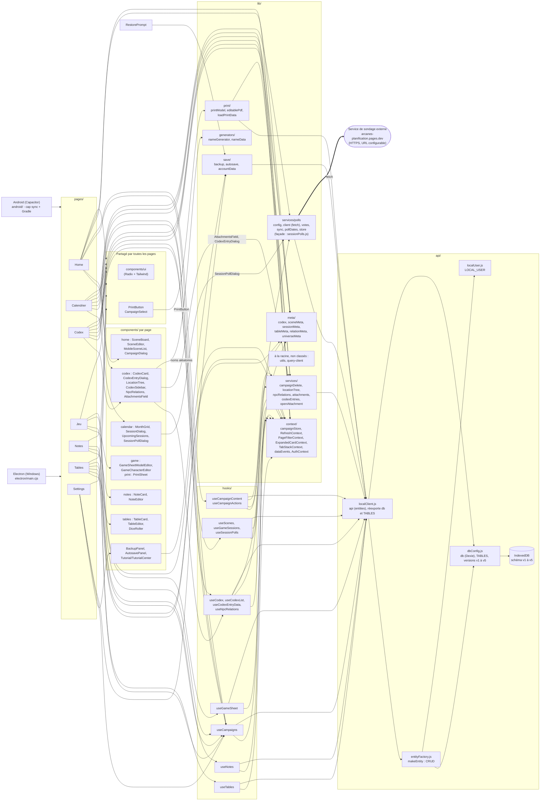

# Architecture - Arcanes Scenario

Règle d'or : ni les pages ni les composants n'appellent `api` ou Dexie. Tout passe par un hook (`hooks/`) ou une fonction de `lib/services/`. `npm run check` le vérifie.

## État du refactor

- Les 7 pages et les composants n'importent plus `api` : seuls `hooks/`, `lib/` et `api/` y accèdent. Le script `scripts/check-refactor.mjs` (`npm run check`) échoue si une page ou un composant le fait.
- `lib/` est découpé en `meta`, `context`, `services` (avec `services/polls`), `save`, `print` et `generators`.
- `src/api/` est découpé en `dbConfig.js` (Dexie, `TABLES`, versions), `entityFactory.js` (`makeEntity`), `localClient.js` (`api`) et `localUser.js` (`LOCAL_USER`).
- `openAttachment` est dans `lib/services/` : types MIME autorisés (pdf, png, jpeg, gif, webp, avif), URL distantes en https uniquement.
- ESLint (`eslint.config.js`) couvre tout `src/` sauf `components/ui/`.
- `Layout` est dans `components/` et `PageNotFound` dans `pages/`.
- `RestorePrompt` passe par `lib/save/backup.js` (`hasCampaigns`) et n'accède plus à `db`.
- `sessionPolls.js` est une façade qui réexporte les fichiers de `services/polls/`.
- La confirmation de suppression d'un sondage depuis la page Calendrier passe par une `AlertDialog` (plus de `window.confirm` dans `useSessionPolls`).
- `progress` (statuts des scènes) n'est plus calculé : aucune page ne l'utilisait.

## Plateformes

- **Electron (Windows)** : `electron/main.cjs` et `preload.cjs` (`window.arcanesPdf`, sauvegardes dans `Documents\Arcanes Scenario`). Installateur via `npm run dist`.
- **Android (Capacitor)** : `android/`, config dans `capacitor.config.ts` (`webDir: "dist"`). Flux : `npm run build`, `npx cap sync android`, puis APK avec Gradle depuis Android Studio. Les ponts Electron n'existent pas sur Android.
- Le même code React (`src/`) sert aux deux.

## Ce qui reste à traiter

- `SessionPollDialog` garde beaucoup de logique réseau et de formulaire ; seule sa persistance locale est dans `services/polls/store.js`. Un hook dédié serait une amélioration possible.
- 4 `window.confirm` restent : `BackupPanel`, `AutosavePanel` (restauration), `GameCharacterEditor` (×2). Prévu : un hook `useConfirm()` basé sur `AlertDialog`.
- `deleteCampaignCascade` (`lib/services/campaignDelete.js`) n'est pas dans une transaction Dexie : une erreur en cours de route laisse une suppression partielle.
- Sur Android, aucun export de sécurité n'est fait avant une restauration (l'autosave est propre à Electron).
- `utils.js` et `query-client.js` sont à la racine de `lib/`, non classés.
- L'entité `Quest` est déclarée dans `dbConfig.js` mais n'est utilisée nulle part.
- Avertissements lint restants : `PageFilterContext.jsx` (destructuration de `setFilter`) et `TutorialOverlay.jsx` (eslint-disable).
- Fins de ligne mixtes (CRLF/LF) : ajouter `.gitattributes` et `.editorconfig` dans un commit séparé.

## Points non vérifiés

- Les flèches de `META` et `CTX` depuis les pages sont déduites des imports lus, pas d'une analyse complète.
- Le pont `window.arcanesBackup` (Electron) n'apparaît pas : il est utilisé par `RestorePrompt` et probablement `autosave`, mais le dossier `electron/` n'a pas été relu.
- Le lien `EF --> LU` (l'usine d'entités utilise `LOCAL_USER` pour `created_by`) est déduit de l'ancien `localClient.js` ; à confirmer dans `entityFactory.js`.
- `tsc` n'a jamais été lancé ; `openAttachment` (option `noopener`) n'a pas été testé sous Electron ni Android.
