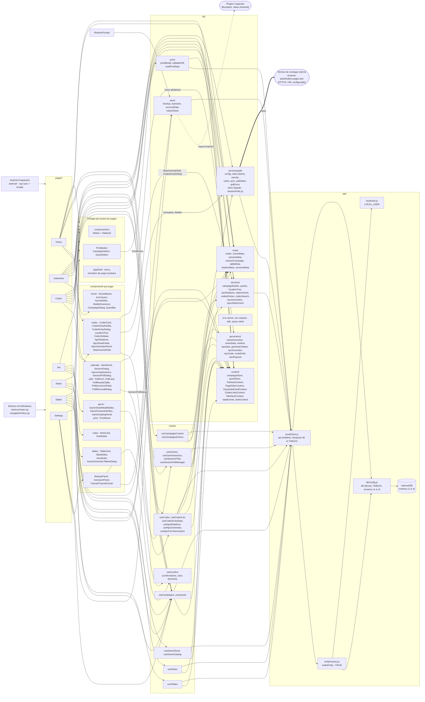

# Architecture - Arcanes Scenario

Règle d'or : ni les pages ni les composants n'appellent `api` ou Dexie. Tout passe par un hook (`hooks/`) ou une fonction de `lib/services/`. `npm run check` le vérifie.

## État du refactor

- Les 7 pages et les composants n'importent plus `api` : seuls `hooks/`, `lib/` et `api/` y accèdent. Le script `scripts/check-refactor.mjs` (`npm run check`) échoue si une page ou un composant le fait.
- `lib/` est découpé en `meta`, `context`, `services` (avec `services/polls`), `save`, `print` et `generators`.
- `src/api/` est découpé en `dbConfig.js` (Dexie, `TABLES`, versions), `entityFactory.js` (`makeEntity`), `localClient.js` (`api`) et `localUser.js` (`LOCAL_USER`).
- `openAttachment` est dans `lib/services/` : types MIME autorisés (pdf, png, jpeg, gif, webp, avif), URL distantes en https uniquement.
- ESLint (`eslint.config.js`) couvre tout `src/` sauf `components/ui/`.
- `Layout` est dans `components/` et `PageNotFound` dans `pages/`.
- `RestorePrompt` passe par `lib/save/backup.js` (`hasCampaigns`) et n'accède plus à `db`.
- `sessionPolls.js` est une façade qui réexporte les fichiers de `services/polls/`.
- La confirmation de suppression d'un sondage depuis la page Calendrier passe par une `AlertDialog` (plus de `window.confirm` dans `useSessionPolls`).
- `SessionPollDialog` est découpé en quatre couches : `lib/services/polls/pollForm.js` (validation, charge utile, aides de dates : fonctions pures), `lib/services/polls/remote.js` (appels au service distant avec le `owner_token` ; `removeSessionPoll` est l'unique chemin de suppression, partagé avec `useSessionPolls`, un 404 du service n'est pas une erreur), `hooks/useSessionPollManager.js` (état du formulaire, liste des sondages, actualisation, clôture, suppression) et `components/calendar/poll/` (`PollServiceUrlField`, `PollForm`, `PollCard`, `PollResultsTable`, `PollRemovalDialog`). La fenêtre elle-même ne fait plus qu'assembler l'affichage.
- `useConfirm()` (`hooks/useConfirm.jsx`) remplace tous les `window.confirm` : `BackupPanel`, `AutosavePanel` (restauration) et `GameCharacterEditor` (×2). Il renvoie une promesse et fournit `confirmDialog` à afficher dans le JSX.
- `deleteCampaignCascade` (`lib/services/campaignDelete.js`) s'exécute dans une seule transaction Dexie : en cas d'erreur, y compris la vérification finale, rien n'est supprimé.
- Android : `lib/save/nativeShare.js` exporte la sauvegarde par la feuille de partage (plugins `@capacitor/filesystem` et `@capacitor/share`, chargés à la demande). Sans sauvegarde automatique (Android, navigateur), `BackupPanel` exporte l'état actuel avant tout import.
- Plus d'avertissement de lint : `usePageFilter` destructure `setFilter` ; `TutorialOverlay` garde un `eslint-disable-next-line` justifié (mesure à chaque rendu, sans boucle).
- Fins de ligne LF et UTF-8 sans BOM : `.gitattributes` et `.editorconfig` à la racine.
- `useCodexList` échappe le terme de recherche avant de le passer à `$regex` (une recherche comme `a.c` ou `(` est traitée comme du texte).
- Testés à la main par l'utilisateur le 17/10/2026, tout passe : export Android (feuille de partage), import avec export préalable, les confirmations `useConfirm` (dont celle de la fiche personnage sur mobile) et la suppression de campagne.
- `progress` (statuts des scènes) n'est plus calculé : aucune page ne l'utilisait.

## Génération de PNJ et Codex (1.6)

- `lib/generators/` est pur (aucun accès aux données) : tirage à graine, données par univers, tables du MJ fusionnées avec les tables intégrées, `generateNpc`, barème (`npcScale`) et `npcRequest`. Le chargement et l'enregistrement passent par `lib/services/npcGeneration.js` et `hooks/useNpcGenerator.js` ; `useNpcFormGeneration` remplit le formulaire (cadenas, confirmation avant écrasement, genre comme paramètre).
- Les verrous (cadenas) sont enregistrés avec le PNJ dans `NPC.generation_locks` (`{ rubrique: true }`) et relus à la modification (`useNpcFormGeneration` reçoit `initialLocks`). Dexie `update` fusionne les lignes : pas de nouvelle `db.version`.
- Les tables du MJ sont dans `Campaign.generator_data`, le barème dans `GameSheetModel.scale` : pas de nouvelle `db.version`, la sauvegarde les inclut déjà. Le bouton « Tables du générateur » est sur la page Tables aléatoires (`components/home/GeneratorTablesDialog.jsx`).
- La fiche d'un PNJ suit la forme d'une fiche de personnage : caractéristiques `{ value, fields }`, compétences et équipement avec champs facultatifs.
- Codex : `CODEX_PAGE_TABS` (PNJ, lieux, indices) pour la page, `CODEX_TABS` (avec personnages) pour le panneau de l'accueil. `CodexEntryDetails` affiche une fiche entière (cartes et panneau, y compris les personnages du panneau de l'accueil). La recherche (`lib/services/codexSearch.js`, fonctions pures) parcourt toute la fiche et accepte des filtres `rubrique:"valeur"`. Les valeurs et liens cliquables passent par `CodexLinksContext`, fourni par la page Codex et par `CodexSidebar`.

## Version 1.6.1 (26/10/2026) : ajouts depuis 1.6.0

- **Calendrier toutes campagnes.** `useGameSessions` charge les sessions d'une campagne ou de toutes (interrupteur « Toutes les campagnes », nom de la campagne affiché). `saveSession(form, { campaignName })` range une nouvelle session dans la campagne choisie dans `SessionDialog`, ou crée une campagne vierge (`{ name, system: "", summary: "", universe_type: "arcanes" }`) quand la valeur est `NEW_CAMPAIGN` (`lib/meta/sessionCampaign.js`), dans `withDataBatch` : si l'enregistrement échoue, la campagne créée est supprimée.
- **Catalogues de la page Jeu.** Onglets Personnages, Compétences, Équipements (`GameTabBar` et `GameCatalogPanel` dans `components/game/GameCatalogPanel.jsx`, données par `hooks/useGameCatalog(campaignId, kind)` sur les entités `SkillCatalog` et `EquipmentCatalog`). Ajout, modification et suppression ; deux éléments ne peuvent pas porter le même nom ; un équipement garde les valeurs de ses champs facultatifs conservés. Les fiches gardent leur propre copie : renommer ou supprimer dans le catalogue ne modifie jamais une fiche existante, et il n'y a pas de bouton de synchronisation (volontaire : il écraserait des retouches manuelles).
- **Transition de page « rouleau ».** `AppShell.jsx` intercepte le clic sur un lien du menu (`a[href^='#/']`), pose `data-turn="forward"|"back"` sur `<html>` (sens selon `PAGE_ORDER`) et lance `document.startViewTransition` ; la navigation se fait dans le callback, qui attend (`settle`, avec `setTimeout`, car `requestAnimationFrame` est gelé pendant la capture) que la nouvelle page soit affichée. Les règles sont à la fin de `index.css`, hors des couches Tailwind (sous le commentaire « Page de grimoire — rouleau (version finale) »), sinon elles sont retirées à la compilation : la nouvelle page est dessous, l'ancienne dessus, masquée par un dégradé (`--roll`, déclaré par `@property`, animé 800 ms, 600 ms sur petit écran ; angle `--roll-angle` 250deg avant, 70deg arrière) ; un élément vide `.page-roll` porte la bande d'ombre ; `.page-transition` reçoit un fond opaque pendant la transition (sinon la nouvelle page se voit à travers l'ancienne). `html[data-vt]` coupe le petit glissement d'origine (`page-enter`) quand la transition de vue prend la main ; sans transition de vue ou avec animations réduites, il reste actif. Une seule animation à la fois (un clic pendant une animation navigue normalement). `App.jsx` précharge les pages après 1,5 s.
- **Scène visible.** `ActColumn.jsx` (repère `data-scene-id` sur chaque scène) ramène l'acte et la scène sélectionnée dans la zone visible 260 ms après l'élargissement de la colonne : défilement horizontal du tableau, à gauche du panneau Codex (`aside[data-keep-expanded]`), et vertical de la page, avec 24 px de marge.
- **Bordure des fiches sélectionnées.** La bordure lumineuse (`ring-2`) dépasse de 2 px : une grille de fiches avec `overflow-hidden` doit avoir `-m-1 w-[calc(100%+0.5rem)] max-w-none p-1` (Codex, Tables aléatoires, Notes).
- Badge d'état (allié, hostile, neutre ; indice caché, info connue) au-dessus du nom, sur la carte du Codex et dans le panneau de l'accueil.
- Fenêtre de modification du Codex : titre « Modifier — nom saisi ». Bouton « Ajouter un équipement » sous le libellé « Équipement » des fiches de PNJ.

## Version 1.6.2 : quêtes, ordre des onglets, outils de contrôle

- **Arbre Campagne > Quête > Acte > Scène.** L'entité `Quest` (déjà dans le schéma v5, donc sans nouvelle `db.version`) porte `campaign_id`, `title` (« Quête principale » par défaut) et `order`. `Act.quest_id` et `Scene.quest_id` rattachent les éléments ; `Scene.recurring_group` non vide marque une scène récurrente.
- **`lib/services/quests.js`** concentre la logique : `loadQuests`, `ensureQuests` (migration), `createQuest`, `renameQuest`, `deleteQuest`, `makeRecurring`, `stopRecurring`. `ensureQuests` tourne dans `loadTree` (`useCampaignContent`), dans une seule transaction Dexie (relecture à l'intérieur, écritures silencieuses) : les actes et scènes sans quête sont adoptés par la première quête ; « Quête principale » n'est créée que si la campagne n'a aucune quête et a des éléments sans quête. Une campagne peut finir sans quête (la dernière quête est supprimable et n'est pas recréée).
- **Scènes récurrentes** : une copie indépendante dans chaque quête, même `recurring_group`. `createQuest` copie chaque groupe dans la nouvelle quête. Une copie reprend les liens (PNJ, lieux, indices, personnages ; `next_scene_ids` seulement vers les copies faites dans le même appel) et démarre en « brouillon ». Supprimer une copie ne supprime pas les autres.
- **Quête active** : `lib/context/questStore.js` (localStorage `arcanes_quest_id:<campagne>` avec repli en mémoire) lu par `hooks/useQuests.js` ; `components/common/QuestSelect.jsx` est affiché à côté de `CampaignSelect` (masqué s'il y a moins de 2 quêtes). La page Home filtre actes et scènes sur la quête active (`QuestBar` : choisir, renommer, supprimer, créer ; `SceneEditor` : choix de la quête, interrupteur « Scène récurrente »). Sur Codex, Tables, Notes et Jeu, le sélecteur ne fixe que la quête proposée par défaut à l'impression. Le Calendrier filtre « Scène prévue » sur la quête active mais garde la scène déjà liée (`useScenes` ajoute `in_quest` et `quest_title`).
- **Impression par quête** : `scopeToQuests` (`lib/print/printModel.js`) puis `buildTrees` (niveau « Quête » s'il y en a plusieurs) et `buildPrintModel` (un bloc « Scènes · quête » par quête, titre seulement si la campagne a plusieurs quêtes). Les lignes sans `quest_id` appartiennent à la première quête. `PrintButton` propose une case par quête, une au moins reste cochée.
- **Ordre des onglets** : Arborescence, Codex, Système de jeu, Notes de MJ, Tables, Calendrier, Paramètres. À modifier ensemble dans `SideRail.jsx`, `MobileNav.jsx`, `TabStackContext.jsx` (TAB_ROOTS), `MobileBackBar.jsx`, `AppShell.jsx` (`PAGE_ORDER`, sens du rouleau) et `config/tutorials.js`.
- **Tests automatiques** : `npm test` (Vitest + `fake-indexeddb`, `vitest.config.js`, dossier `tests/` hors du périmètre ESLint). La vraie couche Dexie tourne sur une IndexedDB simulée vidée avant chaque test. Couverture : entités, quêtes (dont trois `ensureQuests` simultanés), suppression de campagne et annulation, sauvegarde aller-retour et restauration atomique, arbre des lieux, relations de PNJ, recherche du Codex, générateurs et barèmes, impression par quête, sondages. 81 tests verts au 28/10/2026.
- **Inventaire** : `npm run inventaire` (`scripts/inventaire.mjs`) écrit `Docs/inventaire-<date>.md` : fichiers orphelins, exports inutilisés, usage par page, comparaison avec `Docs/Fonctionnalites.md` (indices à vérifier à la main). Il refuse d'écraser un rapport sans `--force`.

## Plateformes

- **Electron 44.9.0 (Windows)** : `electron/main.cjs`, `preload.cjs` et `navigationPolicy.cjs` (`window.arcanesPdf`, `window.arcanesBackup`, sauvegardes dans `Documents\Arcanes Scenario`). La fenêtre est en `sandbox`, avec isolation de contexte ; les canaux IPC (`handle()`) n'acceptent que la page principale ; `window.open` n'autorise que `blob:` (liens `https:`/`http:`/`mailto:` envoyés au système, reste refusé) ; la fenêtre principale ne navigue que vers `file:`. Installateur via `npm run dist`.
- **Android (Capacitor)** : `android/`, config dans `capacitor.config.ts` (`webDir: "dist"`). Flux : `npm run build`, `npx cap sync android`, puis APK avec Gradle depuis Android Studio. Les ponts Electron n'existent pas sur Android ; l'export manuel passe par `@capacitor/filesystem` et `@capacitor/share`. La version Android (`versionName`, `versionCode` dans `android/app/build.gradle`) est indépendante de `package.json` : à mettre à jour à chaque release (1.6.1 = 161).
- Le même code React (`src/`) sert aux deux.

- Sécurité du 19/10/2026 : `@capacitor/assets` retiré (inutilisé, il tirait `tar` 6 et `sharp`), Electron 31.7.7 -> 44.9.0, react-router-dom 6.30.6 -> 7.18.4, tous les paquets en `devDependencies` (l'installateur n'embarque plus de `node_modules` d'exécution : l'interface est déjà regroupée par Vite). `electron/main.cjs` durci (voir Plateformes). `npm audit` : 26 alertes dont 1 critique -> 20 (15 modérées, 5 hautes), voir ci-dessous.

## Ce qui reste à traiter

- `utils.js` et `query-client.js` sont à la racine de `lib/`, non classés.
- Les sélecteurs de quête de Codex, Tables, Notes et Jeu ne servent qu'à l'impression par défaut : ces pages n'affichent pas leur contenu par quête.
- `npm audit` : 20 alertes acceptées au 19/10/2026 (0 critique, 5 hautes, 15 modérées) : `tailwindcss` 3 et sa chaîne de build (seule correction : tailwindcss 4, migration lourde ; s'exécute à la build sur nos propres fichiers), `@capacitor/cli` via `xcode`/`uuid` (la correction proposée est un retour en arrière) et la chaîne d'emballage `electron-builder`. Ne pas lancer `npm audit fix --force`. `npm audit --omit=dev` renvoie 0 parce que tout est en `devDependencies` : ce n'est pas une preuve que l'interface est sans alerte.

## Points non vérifiés

- Les flèches de `META` et `CTX` depuis les pages sont déduites des imports lus, pas d'une analyse complète.
- Le pont `window.arcanesBackup` (Electron) est utilisé par `lib/save/autosave.js` et `AutosavePanel`. `electron/` a été relu le 19/10 et testé à la main par l'utilisateur sous Electron 44.9.0 (sauvegarde automatique, PDF éditable, impression, pièce jointe, liens et courriel des sondages, correcteur, menu contextuel, `release\win-unpacked`).
- `tsc` n'a jamais été lancé ; `openAttachment` (option `noopener`) n'a pas été testé sous Android (WebView). Les changements des versions Electron 32 à 43 n'ont pas été relus un par un : seule la page des changements de la 44 l'a été, la validation repose sur les tests manuels.
- Le cas d'une très grosse base avec beaucoup d'images n'a pas été précisé lors des tests de l'export Android.
- Transition de page « rouleau » : testée par l'utilisateur sous Windows (Electron) et sous Android.
- Quêtes et nouvel ordre des onglets : testés à la main sous Windows (28/10/2026), logique couverte par `npm test` ; non testés sous Android.
