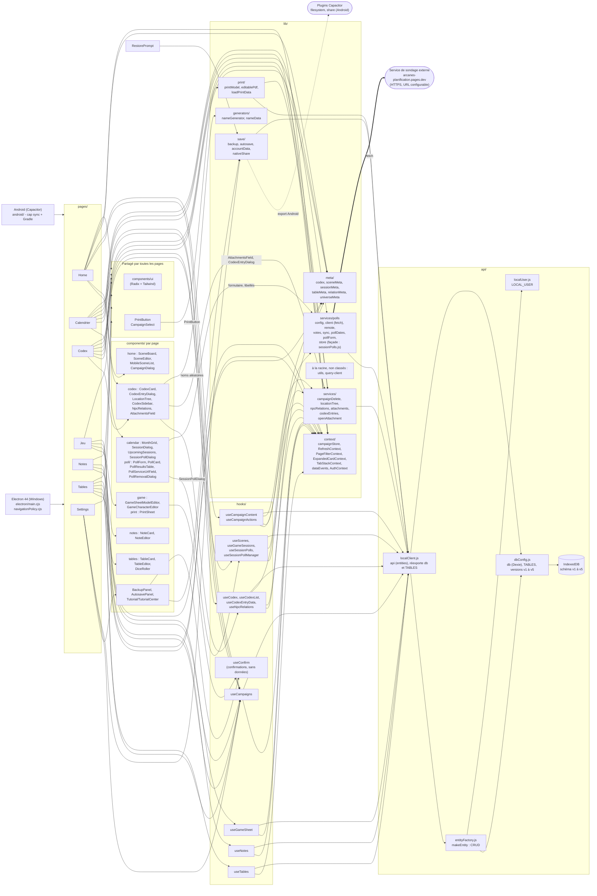

# Architecture - Arcanes Scenario

Règle d'or : ni les pages ni les composants n'appellent `api` ou Dexie. Tout passe par un hook (`hooks/`) ou une fonction de `lib/services/`. `npm run check` le vérifie.

## État du refactor

- Les 7 pages et les composants n'importent plus `api` : seuls `hooks/`, `lib/` et `api/` y accèdent. Le script `scripts/check-refactor.mjs` (`npm run check`) échoue si une page ou un composant le fait.
- `lib/` est découpé en `meta`, `context`, `services` (avec `services/polls`), `save`, `print` et `generators`.
- `src/api/` est découpé en `dbConfig.js` (Dexie, `TABLES`, versions), `entityFactory.js` (`makeEntity`), `localClient.js` (`api`) et `localUser.js` (`LOCAL_USER`).
- `openAttachment` est dans `lib/services/` : types MIME autorisés (pdf, png, jpeg, gif, webp, avif), URL distantes en https uniquement.
- ESLint (`eslint.config.js`) couvre tout `src/` sauf `components/ui/`.
- `Layout` est dans `components/` et `PageNotFound` dans `pages/`.
- `RestorePrompt` passe par `lib/save/backup.js` (`hasCampaigns`) et n'accède plus à `db`.
- `sessionPolls.js` est une façade qui réexporte les fichiers de `services/polls/`.
- La confirmation de suppression d'un sondage depuis la page Calendrier passe par une `AlertDialog` (plus de `window.confirm` dans `useSessionPolls`).
- `SessionPollDialog` est découpé en quatre couches : `lib/services/polls/pollForm.js` (validation, charge utile, aides de dates : fonctions pures), `lib/services/polls/remote.js` (appels au service distant avec le `owner_token` ; `removeSessionPoll` est l'unique chemin de suppression, partagé avec `useSessionPolls`, un 404 du service n'est pas une erreur), `hooks/useSessionPollManager.js` (état du formulaire, liste des sondages, actualisation, clôture, suppression) et `components/calendar/poll/` (`PollServiceUrlField`, `PollForm`, `PollCard`, `PollResultsTable`, `PollRemovalDialog`). La fenêtre elle-même ne fait plus qu'assembler l'affichage.
- `useConfirm()` (`hooks/useConfirm.jsx`) remplace tous les `window.confirm` : `BackupPanel`, `AutosavePanel` (restauration) et `GameCharacterEditor` (×2). Il renvoie une promesse et fournit `confirmDialog` à afficher dans le JSX.
- `deleteCampaignCascade` (`lib/services/campaignDelete.js`) s'exécute dans une seule transaction Dexie : en cas d'erreur, y compris la vérification finale, rien n'est supprimé.
- Android : `lib/save/nativeShare.js` exporte la sauvegarde par la feuille de partage (plugins `@capacitor/filesystem` et `@capacitor/share`, chargés à la demande). Sans sauvegarde automatique (Android, navigateur), `BackupPanel` exporte l'état actuel avant tout import.
- Plus d'avertissement de lint : `usePageFilter` destructure `setFilter` ; `TutorialOverlay` garde un `eslint-disable-next-line` justifié (mesure à chaque rendu, sans boucle).
- Fins de ligne LF et UTF-8 sans BOM : `.gitattributes` et `.editorconfig` à la racine.
- `useCodexList` échappe le terme de recherche avant de le passer à `$regex` (une recherche comme `a.c` ou `(` est traitée comme du texte).
- Testés à la main par l'utilisateur le 17/10/2026, tout passe : export Android (feuille de partage), import avec export préalable, les confirmations `useConfirm` (dont celle de la fiche personnage sur mobile) et la suppression de campagne.
- `progress` (statuts des scènes) n'est plus calculé : aucune page ne l'utilisait.

## Plateformes

- **Electron 44.9.0 (Windows)** : `electron/main.cjs`, `preload.cjs` et `navigationPolicy.cjs` (`window.arcanesPdf`, `window.arcanesBackup`, sauvegardes dans `Documents\Arcanes Scenario`). La fenêtre est en `sandbox`, avec isolation de contexte ; les canaux IPC (`handle()`) n'acceptent que la page principale ; `window.open` n'autorise que `blob:` (liens `https:`/`http:`/`mailto:` envoyés au système, reste refusé) ; la fenêtre principale ne navigue que vers `file:`. Installateur via `npm run dist`.
- **Android (Capacitor)** : `android/`, config dans `capacitor.config.ts` (`webDir: "dist"`). Flux : `npm run build`, `npx cap sync android`, puis APK avec Gradle depuis Android Studio. Les ponts Electron n'existent pas sur Android ; l'export manuel passe par `@capacitor/filesystem` et `@capacitor/share`. La version Android (`versionName`, `versionCode` dans `android/app/build.gradle`) est indépendante de `package.json` : à mettre à jour à chaque release.
- Le même code React (`src/`) sert aux deux.

- Sécurité du 19/10/2026 : `@capacitor/assets` retiré (inutilisé, il tirait `tar` 6 et `sharp`), Electron 31.7.7 -> 44.9.0, react-router-dom 6.30.6 -> 7.18.4, tous les paquets en `devDependencies` (l'installateur n'embarque plus de `node_modules` d'exécution : l'interface est déjà regroupée par Vite). `electron/main.cjs` durci (voir Plateformes). `npm audit` : 26 alertes dont 1 critique -> 20 (15 modérées, 5 hautes), voir ci-dessous.

## Ce qui reste à traiter

- `utils.js` et `query-client.js` sont à la racine de `lib/`, non classés.
- L'entité `Quest` est déclarée dans `dbConfig.js` mais n'est utilisée nulle part.
- `npm audit` : 20 alertes acceptées au 19/10/2026 (0 critique, 5 hautes, 15 modérées) : `tailwindcss` 3 et sa chaîne de build (seule correction : tailwindcss 4, migration lourde ; s'exécute à la build sur nos propres fichiers), `@capacitor/cli` via `xcode`/`uuid` (la correction proposée est un retour en arrière) et la chaîne d'emballage `electron-builder`. Ne pas lancer `npm audit fix --force`. `npm audit --omit=dev` renvoie 0 parce que tout est en `devDependencies` : ce n'est pas une preuve que l'interface est sans alerte.

## Points non vérifiés

- Les flèches de `META` et `CTX` depuis les pages sont déduites des imports lus, pas d'une analyse complète.
- Le pont `window.arcanesBackup` (Electron) est utilisé par `lib/save/autosave.js` et `AutosavePanel`. `electron/` a été relu le 19/10 et testé à la main par l'utilisateur sous Electron 44.9.0 (sauvegarde automatique, PDF éditable, impression, pièce jointe, liens et courriel des sondages, correcteur, menu contextuel, `release\win-unpacked`).
- `tsc` n'a jamais été lancé ; `openAttachment` (option `noopener`) n'a pas été testé sous Android (WebView). Les changements des versions Electron 32 à 43 n'ont pas été relus un par un : seule la page des changements de la 44 l'a été, la validation repose sur les tests manuels.
- Le cas d'une très grosse base avec beaucoup d'images n'a pas été précisé lors des tests de l'export Android.
