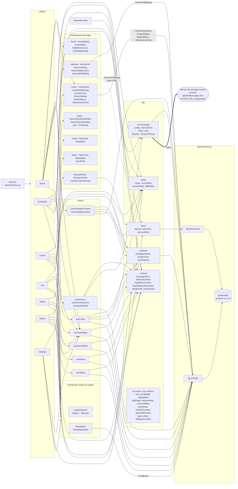

# Architecture - Arcanes Scenario

Mise à jour après le refactor : les 7 pages passent par des hooks, plus aucune page n'importe `api`.

## Ce qui reste à traiter

- 6 composants appellent encore `api` directement : `SessionPollDialog`, `CodexEntryDialog`, `CodexSidebar`, `NpcRelations`, `AttachmentsField`, `PrintButton`.
- Fichiers non classés à la racine de `lib/` (voir le bloc `MISC` du diagramme).
- `localClient.js` mélange schéma, CRUD et utilisateur local (`LOCAL_USER`).
- La progression par statut (`progress`) est calculée dans `useCampaignContent` mais n'est lue par aucune page.
- `deletePoll` (dans `useSessionPolls`) utilise `window.confirm` au lieu d'un `AlertDialog`.

## Points non vérifiés

- Les flèches de `META` et `CTX` depuis les pages sont déduites des imports que j'ai lus, pas d'une analyse complète.
- Le lien de `RestorePrompt` vers `SAVE` suppose que `hasCampaigns()` a bien été ajoutée à `lib/save/backup.js`.
- Le pont `window.arcanesBackup` (Electron) n'apparaît pas : il est utilisé par `RestorePrompt` et probablement par `autosave`, mais je n'ai pas vu `electron/`.